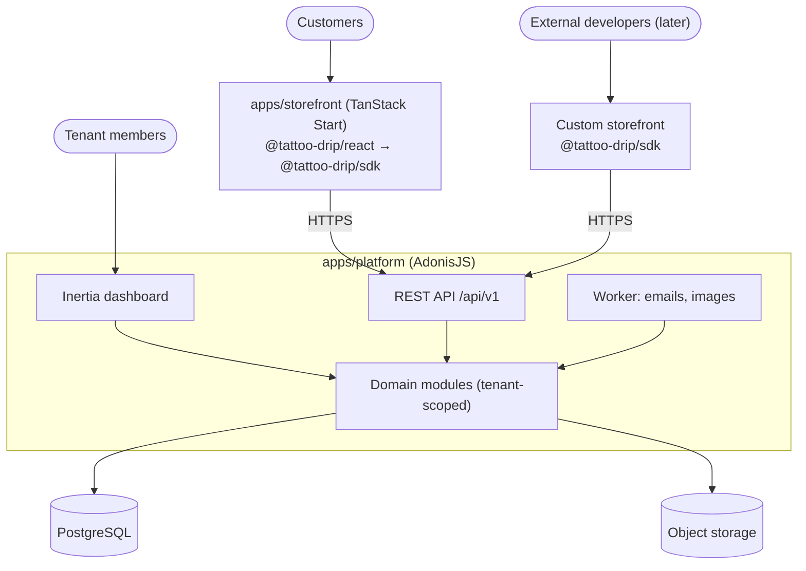

# Architecture

A **modular monolith**: one AdonisJS app owns the data, the business rules and the API, and runs as a web process plus a worker. The dashboard (Inertia + React) lives inside it. The storefront is a separate TanStack Start app that talks to the platform only through the API. There are no microservices.



## Monorepo

The monorepo uses pnpm workspaces, with Biome for formatting and linting.

```text
apps/platform      AdonisJS 7 + Inertia + React: dashboard, REST API, worker
apps/storefront    TanStack Start: hosted storefront
packages/types     @tattoo-drip/types: openapi.yaml + generated types
packages/sdk       @tattoo-drip/sdk: framework-independent API client
packages/react     @tattoo-drip/react: TanStack Query hooks
```

- The storefront never imports from `apps/platform`, and `packages/*` never import from `apps/*`.
- Packages are consumed from source inside the workspace.
- A `packages/ui` package is added when the first component is actually shared.

## Backend modules

Each module owns its models and services. Other modules call its services instead of querying its tables. Inertia controllers, API controllers and jobs stay thin and call the **same** services, so every rule lives in one place. In `apps/platform`, each module is a folder in `app/modules/<module>/` (see [platform backend conventions](../apps/platform/docs/backend.md)).

| Module | Owns | Stage |
|---|---|---|
| Identity | Users, auth, email verification | MVP |
| Tenancy | Tenants, memberships, invites, roles, tenant context | MVP |
| Artists | Artist profiles | MVP |
| Clients | Clients matched by phone, history | MVP |
| Inquiries | Intake, reference images, abuse protection | MVP |
| Projects | Projects, lifecycle, quotes, notes | MVP |
| Payments | Payment methods (studio QR codes), deposit pages, proofs, verification, balance. Gateways in V1 | MVP |
| Scheduling | Sessions, artist calendar, no-overlap. Availability, exceptions and slots in V1 | MVP |
| Notifications | Staff alerts (MVP), click-to-chat templates (MVP), SMS reminders (V1) | MVP |
| Reports | Pilot metrics (MVP), owner reports (V1) | MVP |
| Storefront | The studio page's public reads: the profile and the visible artists (TAT-44). Configuration and themes in V1 | MVP |
| Catalog | Services, flash, style and placement lists | V1 |
| Portfolio | Portfolio items and images | V1 |

## Tenant context

The tenant is always in the URL.

| Entry point | Tenant comes from | Checked |
|---|---|---|
| Dashboard | `/t/blackneedle/projects` | Membership and role, on every request |
| REST API | `/api/v1/tenants/blackneedle/…` | The tenant exists; old slugs answer reads as aliases, writes need the current slug |
| Studio page | The host: `blackneedle.platform.com` | The API confirms the studio on each request; an old slug redirects (302) to the current subdomain; anything else is a 404 page |

The URL works better than a session or a header:
- Tabs open on different tenants each act on the tenant on screen.
- A path works for any client on any domain.
- The URL is a correct CDN cache key.

The studio page reads only the `Host` header, never `X-Forwarded-Host`, because the CDN keys its cache by host.

Isolation has several layers:

1. Middleware resolves the tenant and checks the membership.
2. Services scope every query by tenant. Never trust a tenant ID sent in a request body.
3. **PostgreSQL row-level security** on tenant-owned tables. The app connects as a role that doesn't own the tables, and sets the tenant per transaction with `SET LOCAL`. If no tenant is set, queries return no rows.
4. Composite foreign keys block links between tenants (see [data-model](data-model.md)).
5. Every tenant-owned endpoint has a test proving that tenant A can't reach tenant B's data.

Which role may use each dashboard route is one table (`TENANT_ROUTE_ROLES`), read on every request; which records an artist reaches is the owning module's service rule (TAT-30).

## Domains, sessions, auth

- Studio pages run on `{slug}.<studio domain>` (later also a studio's own domain, TAT-79). The dashboard (`app.`) and the API (`api.`) run on a **separate** registrable domain, so no studio page is ever same-site with the dashboard and none can read or set its cookies. With `NODE_ENV=production` the platform refuses to start when `APP_URL` is not https, or sits on, under or above the studio pages' domain (`STOREFRONT_URL`); a sibling under a shared parent can't be detected and is a checklist item.
- The dashboard session cookie is `__Host-td-session` in production: host-only (no `Domain`), `Path=/`, `HttpOnly`, `Secure` and `SameSite=Lax`. Development and tests use `td-session` without `Secure`, since they run over plain http. CSRF protection (Shield) is on for every dashboard write; its `XSRF-TOKEN` cookie keeps the name Shield and Inertia use, and a token is valid only with its own session.
- The public API is stateless and cookieless. CORS is open on its public endpoints, without credentials.
- Auth uses AdonisJS's session guard with email and password. The session holds the account's session version as well as its id, so a password reset, a password change or "sign out of other devices" (TAT-95) signs out sessions although production keeps sessions in cookies. Email confirmation and password reset use single-use links (a token stored only as its SHA-256, one per account and purpose); creating a tenant or accepting an invitation needs a confirmed address. Login, signup, password reset and the links are rate-limited, and neither signup nor a reset request reveals whether an address has an account (TAT-18).

## Request flows

**Intake (customer → API)**
1. The studio page maps `blackneedle.platform.com` to the `blackneedle` slug and loads the profile and artists through the SDK.
2. The browser sends the inquiry and reference images **directly to the API** as one multipart request, with the bot-challenge token in a header. Going direct avoids storefront body-size limits, lets rate limits see the real IP, and leaves no orphaned uploads. The studio page first re-encodes the photos as JPEG in the browser (at most 1600 px), so uploads stay small on slow connections and no EXIF or GPS data leaves the phone.
3. Before it reads the multipart body, the API counts the address, checks the challenge and counts the studio; then it refuses a filled honeypot, validates, counts the phone and processes the images. The Inquiries module matches or creates the client by phone and saves the inquiry as `new`.
4. A job, queued with the inquiry, alerts the studio's owners and the artist the client asked for, once each, by email and in the dashboard (TAT-52).

**Deposit (customer → studio)**
1. Staff accept the inquiry, which creates a project, and send a quote through a one-tap WhatsApp or Viber message; the project moves to `quoted`. When the client agrees, staff mark the quote accepted: the project moves to `deposit_pending`, and an owner sends the deposit page link the same way (`https://<studio>/deposit#<token>`, 30 days). A quote that expires first cancels the project.
2. The client pays with the studio's own QR code and uploads proof on the deposit page, which records a `submitted` payment and alerts the owners. The page reads the token from the link's fragment in the browser only (the studio page's server never sees it) and re-encodes the screenshot as a JPEG first (at most 2048 px, no EXIF).
3. An owner verifies the proof in the dashboard, next to the amount asked and the reference code, and the project moves to `booked` when a session is scheduled; money taken at the desk, refunds and reversals are recorded the same way, and the balance due is computed from them. **No money passes through Tattoo Drip in the MVP**, so no payment licence is needed.

**Dashboard action**
1. "Verify payment" or "Schedule session" runs auth, tenant and role middleware.
2. The Payments or Scheduling service writes in one transaction. The no-overlap constraint settles any race between two sessions.
3. Inertia returns new props.

## Files, scale, hosting

- **Uploads** always go through the API. Images are re-encoded, which strips EXIF data and GPS location and rejects disguised files. They are resized in the request, not in the worker (TAT-21, TAT-112).
  - Built so far (TAT-21 core): re-encoding happens in the request, and images over 2048 px are scaled down there. Copies at 320, 640 and 1280 px are made in the request too, from the cleaned image (TAT-112): artist photos and references; QR codes and payment screenshots keep one size. The API lists them as `variants` and the storefront builds `srcset` from them.
  - HEIC is not decoded (TAT-51): the intake form asks for JPEG, PNG or WebP, which iPhones convert their photos to, and a HEVC decoder would mean a custom libvips build or a WASM decoder running on hostile input.
- **Image visibility:** portfolio images are public behind a CDN. Reference images are private and served through short-lived signed URLs, issued only after a membership check.
- **Caching:** public reads that opt in send `Cache-Control: public, max-age=60, stale-while-revalidate=600` with an ETag behind a CDN; storefront pages use short TTLs too, and slots will have the shortest. Errors and writes are `no-store`. The storefront's own 404 page is kept 60 s at the CDN; its old-slug redirects and API-down page are never stored.
- **Rate limits** apply per caller, before any body is read, and per studio on reads (TAT-38). The storefront's server-side rendering calls the API with a secret **server key** (`STOREFRONT_SERVER_KEY`, as `Authorization: Bearer`, from the server only) and its visitor's address (`X-Visitor-IP`): with a valid key the platform counts those calls per visitor instead of as one client. The key grants no extra data.
- **Jobs** use `@adonisjs/queue` with its database driver: a PostgreSQL-backed queue, with no Redis, run by a separate worker process. Jobs can be queued inside a transaction so they commit with the data. Jobs on tenant data carry their tenant.
- **Email** is sent from the platform domain, with SPF, DKIM and DMARC set up. It is never sent from a tenant's domain.

| Part | Where |
|---|---|
| Storefront | Vercel, root directory `apps/storefront`, wildcard domain |
| Platform web + worker | Containers on a managed host, in the same region as the database |
| PostgreSQL | Managed, with backups and point-in-time recovery |
| Files | Cloudflare R2 (S3 API, no egress fees) + CDN |

## Payments and messaging

- **MVP:** studios upload their own Fonepay, eSewa and Khalti QR codes. Customers pay the studio directly and upload proof, and staff verify it. Tattoo Drip never holds money.
- **V1:** automatic confirmation through Khalti ePayment (start the payment on the server, then confirm it with a lookup), or a dynamic Fonepay QR through an aggregator. A direct Fonepay integration costs each merchant NPR 25,000; aggregators charge per transaction. Decide after the partner talks, and get legal advice on Nepal Rastra Bank rules before collecting money on a studio's behalf.
- **Messaging:** one-tap `wa.me` and `viber://` links with prefilled text. There is no WhatsApp Business, Instagram or Viber Business API: each needs approval and costs money per message or per month, and the [research](research.md) found no evidence that the links aren't enough.
- **Dashboard:** an installable, mobile-first web app (PWA) built with Inertia and React. Native apps are not planned.

## Storefront themes

In the MVP the studio page has one layout, generated from the profile and artists. In V1, themes are React components in the storefront. Tenants never store markup or scripts: their `StorefrontConfiguration` picks a theme and fills in its options.

## Current state

This document describes the intended architecture, including planned features. Determine implemented behavior from the affected modules, routes, migrations and tests; local migration status comes from the target database. Row-level security is implemented; see [database conventions](../apps/platform/database/README.md) and [backend development](../apps/platform/docs/backend.md).

What each stage of the contract exposes is in [SDK: Public API by stage](sdk.md#public-api-by-stage); V1 operations are tagged `V1` in `openapi.yaml`. Use the [roadmap](roadmap.md) for release gates and [documentation index](README.md) for implementation guidance. Dated specs/plans retain the decision history.
