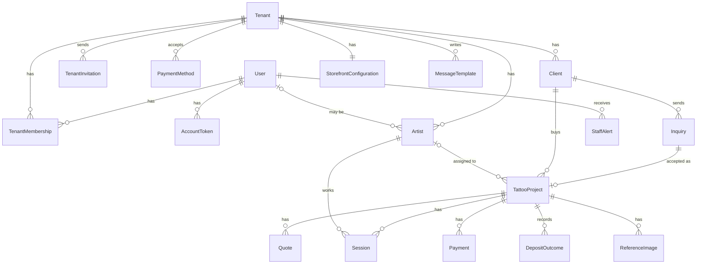

# Data model

This is conceptual: no columns or migrations, only the important fields. The model sells **projects**, not slots. An **Inquiry** becomes a **TattooProject**, which carries the quote, payments and sessions.



Every entity except `User` belongs to a `Tenant`; most of those lines are left out of the diagram.

## Tenant ownership

- `User` is global, and the style and placement lists (V1) are platform data. **Every other entity is tenant-owned** and stores its tenant directly.
- References between tenant-owned rows include the tenant (composite foreign keys), so the database rejects cross-tenant links.
- Users have no `tenant_id`; access is the set of a user's `TenantMembership` rows.
- **Conventions:**
  - Primary keys are UUIDv7.
  - Instants are stored in UTC.
  - Phone numbers are normalized to E.164, defaulting to +977.
  - Money is an integer in minor units (paisa) with a currency, `NPR` by default.

## MVP entities

| Entity | Responsibility |
|---|---|
| **User** | A person who can log in: a canonical email address (trimmed, ASCII letters in lower case, so unique whatever its case), when that address was confirmed (needed to create a tenant or accept an invitation), and a session version that a password reset raises to sign out every session |
| **AccountToken** | A single-use link for one account: confirm its email address (24 hours) or choose a new password (60 minutes). Only the token's SHA-256 is stored, with the address it was sent to; one per account and purpose, replaced by the next, deleted when used |
| **Tenant** | A `studio` or `independent` business: name, slug (every slug it has held is a `TenantSlug`), profile (contact phone and email, address, social links), timezone, default deposit percentage, deposit policy text |
| **TenantSlug** | Every slug a tenant has held, its current one included. One namespace for the whole platform: a slug is never given to another tenant. Written by a database trigger; the app never changes or deletes one |
| **TenantMembership** | One role (`owner` or `artist`) for one user in one tenant |
| **TenantInvitation** | Email (canonical), role, an optional artist profile to claim, and a hashed single-use token that expires after 7 days. One per tenant and address (a new one replaces it); deleted when accepted or cancelled, so a token works once |
| **Artist** | A public profile in one tenant (name, slug, bio, photo, visible, accepting inquiries plus a message), optionally linked to a `User` |
| **PaymentMethod** | A way the studio gets paid: kind (`fonepay`, `esewa`, `khalti`, `bank`, `cash`), a label, and a QR image or account details |
| **Client** | A person who contacts the studio: one live client per normalized phone per tenant; name, optional email, notes. Form input never overwrites an existing client. Every client has a phone until its personal data is scrubbed (`anonymized_at`) |
| **Inquiry** | The first contact, exactly as submitted: idea, placement, approximate size, preferred dates, preferred artist, budget, source channel, contact snapshot. Status `new`, `accepted` or `declined`, with the time of the decision. Its last contact (when, on which channel, with which message) is recorded too. The submitted fields never change (a database trigger); only the privacy deletion can scrub the contact snapshot and free text, and only in the one update that first marks the inquiry anonymized (frozen again afterwards) |
| **TattooProject** | The sale: client, artist, brief, status (see [project rules](requirements.md#project-rules)), last contact (when, on which channel, with which message), notes. Created when an inquiry is accepted, or directly for a walk-in |
| **Quote** | Fixed price, or hourly rate with estimated time (whole minutes); deposit amount (may be zero, never above the total); expiry. A revision is a new row with the next version, the current quote is the highest, and history is never deleted. There are no drafts: saving issues the next version, so `created_at` is when it was sent. Quotes have no trigger: that and "price, deposit and expiry never change after insert" are conventions, and the only database protection is the `NO ACTION` key from a quote to its project |
| **Payment** | Kind (`deposit`, `session`, `balance`, `refund`, `correction`), amount, method (a kind: `fonepay`, `esewa`, `khalti`, `bank` or `cash`), proof image, status (`submitted`, `verified`, `rejected`), who verified it and when, the payment it corrects (a `correction` only, same project, at most one correction per payment), a staff note. Never edited or deleted (a database trigger), except that its decision (status, verifier, decision time) is recorded once, `updated_at` moves and its proof can be cleared (privacy deletion): a refund is a negative payment, a `correction` reverses a mistaken verification, and once verified or rejected a payment is final (its verifier can become empty only when that user's account is deleted) |
| **DepositOutcome** | What happened to a deposit: kept, moved to a new date (with the missed or cancelled session) or refunded (with its refund payment), the deposit money the project still held then (a bigint, after any refund), who recorded it, a note. One per project close and one per session; recorded once, never changed. The studio's policy decides; the app only records |
| **Session** | A time block for one artist inside a project (table `project_sessions`): kind (`consultation`, `tattoo`, `touch_up`), start and end, status (`scheduled`, `completed`, `no_show`, `cancelled`). The database prevents overlapping active sessions for the same artist: a session is active while it is `scheduled` or `completed` and not deleted, and the time is a half-open range, so back-to-back sessions are fine. `completed`, `no_show` and `cancelled` are final |
| **ReferenceImage** | An image from the client, attached to the inquiry and then to its project. Private |
| **MessageTemplate** | A studio's own text for one of its six chat messages (inquiry received, quote, deposit link, booking confirmation, session reminder, aftercare), with placeholders such as `{client_name}`. A row only for a message the studio changed; the defaults are in code |
| **StaffAlert** | One member's alert about one event, a new inquiry or a deposit screenshot (the payment and its project): the member, the kind, the event's ids and when it was read. Ids only, no client data |
| **StorefrontConfiguration** | V1 (TAT-54): one per tenant, a theme and its options (branding, sections). Not a table yet: in the MVP the studio page shows the tenant's profile (intro, contact, links) and the artists whose visible switch is on |

- **Balance due** = the current quote's total (or hours × rate) − verified payments in the quote's currency (refunds and reversals are signed). It is computed, never stored; a project booked without a price has none until its price is set.
- **Inquiry vs project:** the inquiry is an immutable record of what was asked; the project is what the studio manages. Declined inquiries never become projects.
- **One person in two studios:** one `User`, two memberships and two `Artist` profiles. Clients and projects never cross tenants.

## V1 entities

| Entity | Responsibility |
|---|---|
| **Service** | A fixed-price offering (piercing, flash size, consultation) with duration; artist ↔ service mapping |
| **Flash** | A pre-drawn design: image, price, size, one-off or repeatable. Booking one creates a project with a fixed quote |
| **ArtistAvailability**, **AvailabilityException** | Weekly hours and dated overrides (time off, extra hours, studio-wide closures), used for instant booking |
| **PortfolioItem** | Finished work, optionally linked to its project, shown on the studio site |
| **TattooStyle**, **BodyPlacement** | Platform-wide lists with stable slugs |
| **GatewayPayment** | A Khalti or Fonepay transaction behind an automatically confirmed `Payment` |

In V1, bookable slots are computed, never stored:

```text
weekly availability ± exceptions − active sessions
within [now + minimum notice, now + horizon], split by service duration
```

Consent records, commissions and payouts, and locations are V2. They wait for interviews and legal review.
